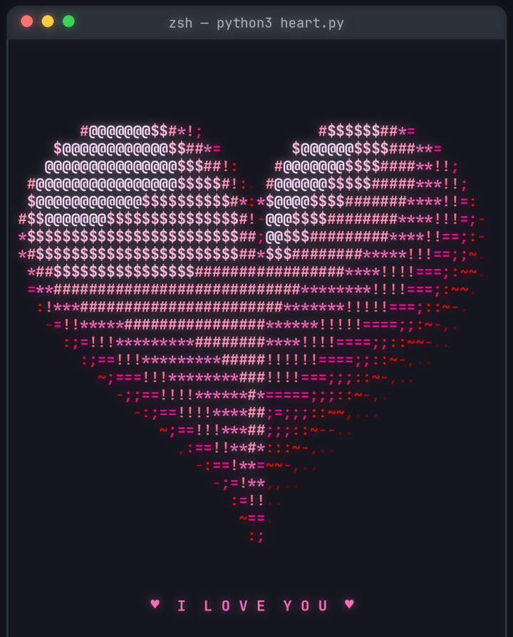

# ❤️ 3D ASCII Heart in Python

A spinning, beating, **3D heart made of ASCII characters**, rendered live in your terminal.
Pure Python. No libraries, no game engine, just math. Day 7 of my 100 Days coding challenge by [@hack.n.code](https://instagram.com/hack.n.code).



## Run it

```bash
python3 heart.py
```

Needs Python 3.8+ and a terminal with 256 colours (macOS Terminal, iTerm, Windows Terminal, VS Code, any Linux terminal).
Make the window at least **56 x 31** characters. Press `Ctrl + C` to stop.

## How it works

1. **The shape**: a puffy heart surface, the classic heart curve `x = 16 sin³v`, `y = 13 cos v − 5 cos 2v − 2 cos 3v − cos 4v`, scaled by `sin u` and given depth `z = 6 cos u`.
2. **Normals**: each sampled point gets a surface normal (cross product of two tiny steps on the surface), used for lighting.
3. **Spin**: every frame the points are rotated around the vertical axis, and a small `sin¹⁶` pulse makes the heart beat.
4. **Projection + z-buffer**: points are projected with perspective, and only the nearest point for each character cell is kept.
5. **Shading**: brightness = normal · light, mapped to `.,-~:;=!*#$@` and to a red-to-pink 256-colour ramp.

Inspired by the famous `donut.c`, but with a heart ❤️

## Ideas to try

- Change `REDS` to your favourite colours
- Change the message in `msg`
- Speed up the spin: `A = t * 2`

---
Made with ❤️ by **@hack.n.code**. Send this to your person 💌
